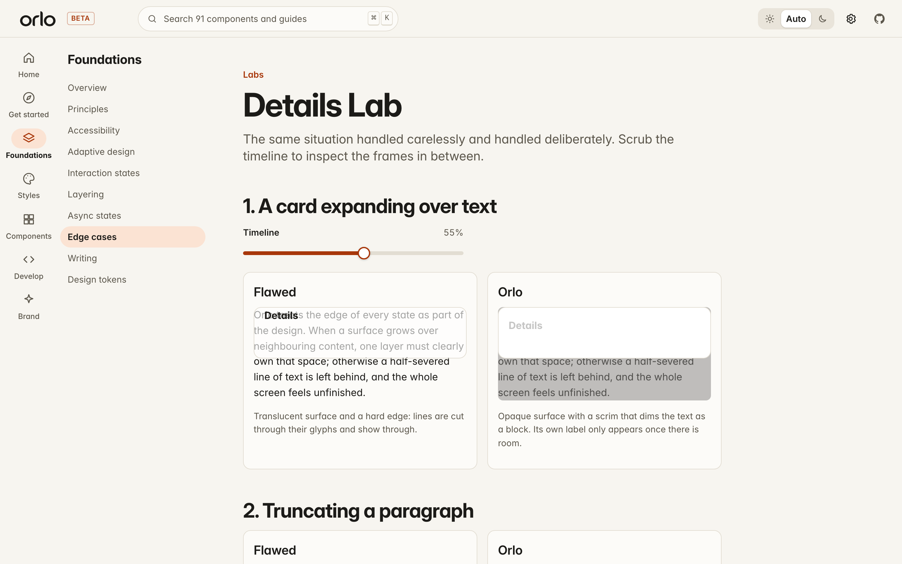
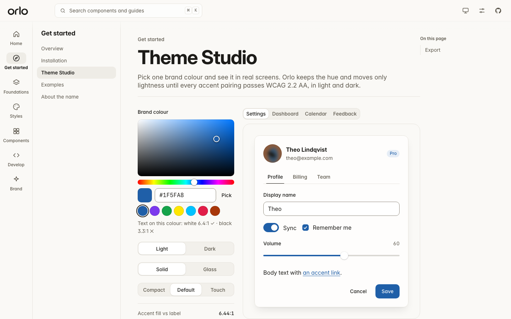

<p align="center">
  
  
</p>

<p align="center"><strong>Design the parts between the moments.</strong><br>An open-source design framework for React by Varun Karthic.</p>

<p align="center"><a href="https://orlo-react.readthedocs.io/en/latest/">Documentation</a> · <a href="https://orlo-react.readthedocs.io/en/latest/components/">Components</a> · <a href="https://orlo-react.readthedocs.io/en/latest/brand/badges/">Embed badges</a> · <a href="https://github.com/varunkarthic/orlo/blob/main/LICENSE">MIT License</a></p>

Orlo is built on the idea that an interface is shaped as much by what happens *between* moments as by what appears on screen. The press, the interrupted transition, the image that never arrives, and the focus that has to come back are all part of the design.

The name is Italian for an edge, rim or hem (pronounced **OR-loh**). A hem is the finish that holds the whole together, even when nobody notices it.

> **Status: beta, pre-release.** 122 components are documented in source; automated coverage is recorded per component in [`components.json`](components.json). None is marked stable yet: that needs manual screen-reader and visual review. Nothing is published to npm.

**Start here:** [getting started](https://orlo-react.readthedocs.io/en/latest/start/) · [browse components](https://orlo-react.readthedocs.io/en/latest/components/) · [learn the design language](https://orlo-react.readthedocs.io/en/latest/foundations/) · [read the lifecycle guide](https://orlo-react.readthedocs.io/en/latest/foundations/lifecycle/)

## Why Orlo

**Everything is built in.** Every component, plus positioning, focus scopes, scroll locking, the layer stack, the icon set and the theme generator, is written for Orlo. The only runtime dependencies are React and the [Motion](https://motion.dev) animation engine. It is not a wrapper around another component library.

**Finished edges.** The Details Lab puts careless behaviour beside deliberate behaviour: half-clipped text under a growing card, focus sent to a trigger that no longer exists, and repeated-click races.



**One motion grammar.** Components ask for a purpose (`press`, `reveal`, `overlay`, `shared`) and Orlo supplies an interruptible spring. Reduced motion replaces travel with a fade; `off` makes changes instant.

**A lifecycle, not a resting frame.** Every component page now carries the same behavioural contract: stable entry, equivalent input acknowledgement, meaningful change, clear resolution, interruption and safe recovery. The [Lifecycle & composition guide](apps/docs/src/pages/FoundationsPages.tsx) defines how overlays, fields, asynchronous actions and nested surfaces hand off focus, layers, state and failure.

**Failure is designed.** Images reserve their space before loading, decode before they appear, retry a limited number of times and fall back to a designed placeholder. `images="off"` makes every managed image a placeholder and stops all image requests.

**Accessibility lives in behaviour.** Orlo follows WAI-ARIA keyboard patterns for menus, tabs, trees, grids, comboboxes and sliders. Modals make the page inert, lock scrolling once and return focus to a valid element. Colour is never the only signal.

**Locale-aware.** The calendar's week start, digits and names come from `Intl`. Number fields parse "1.234,5" in German. Arrow keys and layouts mirror in right-to-left text. The tag input, combobox and command palette ignore keystrokes during IME composition.

## The catalogue

| Family | Components |
|---|---|
| Actions | Button, IconButton, CopyButton, SegmentedControl, ToggleButton, ToggleGroup, SplitButton, Fab, SpeedDial |
| Forms | TextField, TextArea, Select, Checkbox, RadioGroup, Switch, Slider, PasswordField, NumberField, SearchField, Combobox, TagInput, PinInput, RadioCards, RangeSlider, Rating |
| Pickers | Calendar, DatePicker, TimeField, ColorPicker, FileDropzone |
| Navigation | Tabs, Menu, CommandPalette, Breadcrumbs, Pagination, NavigationRail, BottomNavigation, Steps, TableOfContents |
| Overlays | Dialog, AlertDialog, Sheet, Popover, Tooltip, Toast, ContextMenu, HoverCard, Tour |
| Disclosure & layout | Accordion, TreeView, ReadMore, Card, Stack, Divider, Splitter, ScrollArea |
| Data display | Badge, Avatar, Table, AnimatedNumber, Kbd, Chip, DataList, Timeline, Sparkline, Meter, Highlight, RelativeTime |
| Feedback | Alert, Progress, Spinner, Skeleton, EmptyState, Banner, OfflineIndicator, ProgressRing |
| Media | OrloImage, Carousel, BeforeAfter, Lightbox |
| Specialty | Knob, HoldToConfirm, SignaturePad, ShortcutRecorder, ReorderableList, Heatmap, JsonTree, DiffViewer, CodeBlock, Countdown, Marquee, BuiltWithOrlo |

The machine-readable list is [`components.json`](components.json).

## Embeddable badges

Want to credit Orlo in a project footer or README? The optional [`BuiltWithOrlo` badge](https://orlo-react.readthedocs.io/en/latest/brand/badges/) comes in four fixed identity tones, three sizes, and signature, compact, or inline layouts. The signature shows “Open-source design framework for React” and “by Varun Karthic.” The Brand guide includes live previews, copyable React and HTML embeds, and self-contained SVG downloads for non-React sites. No badge is required by the MIT License.

## Documentation that behaves like the library

The docs are an Orlo application in their own right:
- **Live examples.** Each component has a calm preview, alternate states, usage code, anatomy, keyboard behaviour and semantics where relevant.
- **A coherent shell.** Search, preferences, navigation, code and demos use the same tokens and controls as the package.
- **Practical labs.** MotionLab, Theme Studio, Details Lab, failure states and device-focused checks make behaviour inspectable.
- **Static by design.** Every route is prerendered for Read the Docs; deep links work without an application server ([`.readthedocs.yaml`](.readthedocs.yaml)).



## Run it locally

Orlo is not on npm yet. From a clone:

```bash
npm install
npm run dev          # docs + live demos at http://localhost:5173
npm test             # unit and component tests
npm run build:rtd    # static site -> apps/docs/dist
npm run e2e          # Playwright + axe against the built site
```

```tsx
import { OrloProvider, Button, Dialog, TextField, useToast } from "@orlo/react";
import "@orlo/tokens/css";
import "@orlo/react/styles.css";

export function App() {
  return (
    <OrloProvider theme="system" motion="system" images="on">
      <Dialog title="Rename project" trigger={<Button>Rename…</Button>}
        footer={(close) => <Button onClick={close}>Save</Button>}>
        <TextField label="Project name" />
      </Dialog>
    </OrloProvider>
  );
}
```

To theme Orlo from a single colour:

```ts
import { createTheme, themeToCss } from "@orlo/tokens";
const css = themeToCss(createTheme("#1F5FA8"), ":root"); // accent roles meet WCAG AA in light and dark
```

## Repository

```
packages/tokens   design tokens -> CSS custom properties, contrast + theme generator
packages/motion   spring presets, metrics, reduced-motion policy (wraps Motion)
packages/react    components, provider, positioning, focus and layer primitives, icons
apps/docs         prerendered documentation (Read the Docs custom build)
assets/brand      logo SVGs and PNG/ICO exports
docs/             research notes, decisions, status, README media
e2e/              Playwright + axe tests
```

## Verification and limits

| Check | Status |
|---|---|
| Unit and component tests (Vitest) | automated |
| Playwright end-to-end: deep links, focus, menus at edges, search, overflow | automated |
| axe-core on key pages, desktop and mobile | automated |
| Manual screen-reader testing | **not yet done** |
| Visual regression snapshots | not yet automated |

Current details are in [`docs/PROJECT_STATUS.md`](docs/PROJECT_STATUS.md).

## Credits

Orlo's motion principles draw on Apple's Human Interface Guidelines and Material 3 Expressive. It is **not affiliated with Apple, Google, Framer or any other vendor**. Sources and licences are listed in [`docs/research/`](docs/research).

Agents should read [AGENTS.md](AGENTS.md) and [ORLO_DESIGN_RULES.md](ORLO_DESIGN_RULES.md). Licensed under the [MIT License](LICENSE).
