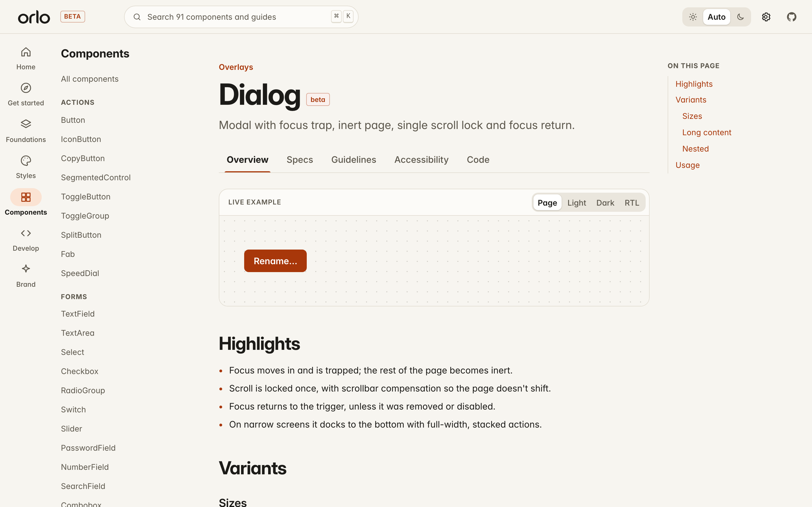

<p align="center">
  
  
</p>

<p align="center"><strong>Nothing is an afterthought.</strong><br>A design framework for React.</p>

<p align="center"></p>

Orlo is built on the idea that an interface is shaped as much by what happens *between* moments as by what appears on screen. The press, the frame between two states, the image that never arrives, the focus that has to come back: Orlo designs those on purpose.

The name is Italian for an edge, rim or hem (pronounced **OR-loh**). A hem is the finish that holds the whole together, even when nobody notices it.

> **Status: beta, pre-release.** 121 components are documented in source; automated coverage is recorded per component in [`components.json`](components.json). None is marked stable yet: that needs manual screen-reader and visual review. Nothing is published to npm.

## What makes it different

**Everything is built in.** Every component, plus positioning, focus scopes, scroll locking, the layer stack, the icon set and the theme generator, is written for Orlo. The only runtime dependencies are React and the [Motion](https://motion.dev) animation engine. It is not a wrapper around another component library.

**Finished edges.** The Details Lab puts each careless version beside the deliberate one: half-clipped text under a growing card, focus sent to a trigger that no longer exists, repeated-click races.


**One motion grammar.** Components ask for a purpose (`press`, `reveal`, `overlay`, `shared`) and Orlo supplies a spring. A test enforces that every preset stays under 5% overshoot and settles within 700 ms. Interrupt an animation and it redirects from its current velocity. Reduced motion turns movement into a fade, and `off` makes changes instant.

**A lifecycle, not a resting frame.** Every component page now carries the same behavioural contract: stable entry, equivalent input acknowledgement, meaningful change, clear resolution, interruption and safe recovery. The [Lifecycle & composition guide](apps/docs/src/pages/FoundationsPages.tsx) defines how overlays, fields, asynchronous actions and nested surfaces hand off focus, layers, state and failure.

**Failure is designed.** Images reserve their space before loading, decode before they appear, retry a limited number of times and fall back to a designed placeholder. `images="off"` makes every managed image a placeholder and stops all image requests.

**Accessibility lives in behaviour.** Orlo follows the WAI-ARIA keyboard patterns for menus, tabs, trees, grids, comboboxes and sliders. Modals make the page inert, lock scrolling once and return focus to a valid element. Colour is never the only signal. Token contrast and axe-core checks run in CI.

**Locale-aware.** The calendar's week start, digits and names come from `Intl`. Number fields parse "1.234,5" in German. Arrow keys and layouts mirror in right-to-left text. The tag input, combobox and command palette ignore keystrokes during IME composition.

## The catalogue

| Family | Components |
|---|---|
| Actions | Button, IconButton, CopyButton, SegmentedControl, ToggleButton, ToggleGroup, SplitButton, Fab, SpeedDial |
| Forms | TextField, TextArea, Select, Checkbox, RadioGroup, Switch, Slider, PasswordField, NumberField, SearchField, Combobox, TagInput, PinInput, RadioCards, RangeSlider, Rating |
| Pickers | Calendar, DatePicker, TimeField, ColorPicker, FileDropzone |
| Navigation | Tabs, Menu, CommandPalette, Breadcrumbs, Pagination, NavigationRail, BottomNavigation, Steps, TableOfContents |
| Overlays | Dialog, AlertDialog, Sheet, Popover, Tooltip, Toast, ContextMenu, HoverCard, Tour |
| Disclosure & layout | Accordion, TreeView, ReadMore, Card, Stack, Divider, Splitter, ScrollArea |
| Data display | Badge, Avatar, Table, AnimatedNumber, Kbd, Chip, DataList, Timeline, Sparkline, Meter, Highlight, RelativeTime |
| Feedback | Alert, Progress, Spinner, Skeleton, EmptyState, Banner, OfflineIndicator, ProgressRing |
| Media | OrloImage, Carousel, BeforeAfter, Lightbox |
| Specialty | Knob, HoldToConfirm, SignaturePad, ShortcutRecorder, ReorderableList, Heatmap, JsonTree, DiffViewer, CodeBlock, Countdown, Marquee |

The machine-readable list is [`components.json`](components.json).

## Documentation

The docs are an Orlo application in their own right:
- **Five tabs per component.** Overview, Specs, Guidelines, Accessibility and Code, with live anatomy callouts, a lifecycle contract and spec values read from the stylesheet.
- **Sections.** Foundations, Styles and Develop.
- **Tools.** A MotionLab, a Theme Studio and ⌘K search.
- **Static hosting.** Every route is prerendered as a separate HTML file, so the site runs on Read the Docs without a server ([`.readthedocs.yaml`](.readthedocs.yaml)).



## Use it

Orlo is not on npm yet. From a clone:

```bash
npm install
npm run dev          # docs + live demos at http://localhost:5173
npm test             # unit and component tests
npm run build:rtd    # static site -> apps/docs/dist
npm run e2e          # Playwright + axe against the built site
```

```tsx
import { OrloProvider, Button, Dialog, TextField, useToast } from "@orlo/react";
import "@orlo/tokens/css";
import "@orlo/react/styles.css";

export function App() {
  return (
    <OrloProvider theme="system" motion="system" images="on">
      <Dialog title="Rename project" trigger={<Button>Rename…</Button>}
        footer={(close) => <Button onClick={close}>Save</Button>}>
        <TextField label="Project name" />
      </Dialog>
    </OrloProvider>
  );
}
```

To theme Orlo from a single colour:

```ts
import { createTheme, themeToCss } from "@orlo/tokens";
const css = themeToCss(createTheme("#1F5FA8"), ":root"); // accent roles meet WCAG AA in light and dark
```

## Repository

```
packages/tokens   design tokens -> CSS custom properties, contrast + theme generator
packages/motion   spring presets, metrics, reduced-motion policy (wraps Motion)
packages/react    components, provider, positioning, focus and layer primitives, icons
apps/docs         prerendered documentation (Read the Docs custom build)
assets/brand      logo SVGs and PNG/ICO exports
docs/             research notes, decisions, status, README media
e2e/              Playwright + axe tests
```

## Verification

| Check | Status |
|---|---|
| Unit and component tests (Vitest) | passing in CI |
| Playwright end-to-end tests: deep links, focus, menus at edges, search, overflow | passing in CI |
| axe-core on key pages, desktop and mobile | passing in CI |
| Manual screen-reader testing | **not yet done** |
| Visual regression snapshots | not yet automated |

Current details are in [`docs/PROJECT_STATUS.md`](docs/PROJECT_STATUS.md).

## Credits

Orlo's motion principles draw on Apple's Human Interface Guidelines and Material 3 Expressive. It is **not affiliated with Apple, Google, Framer or any other vendor**. Sources and licences are listed in [`docs/research/`](docs/research).

Agents should read [AGENTS.md](AGENTS.md) and [ORLO_DESIGN_RULES.md](ORLO_DESIGN_RULES.md). Licensed under the [MIT License](LICENSE).
